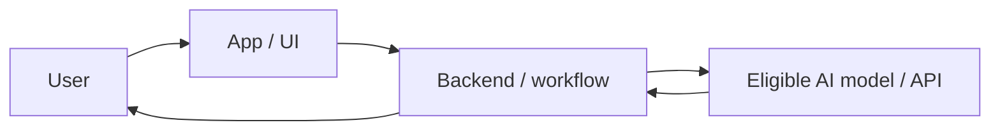
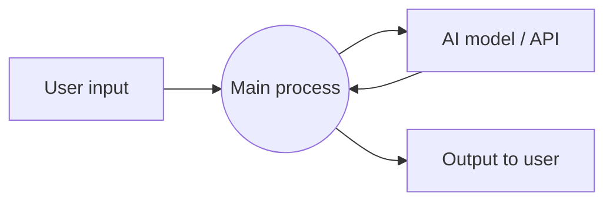

# Hacktoberfest Islamabad 2026 — Rules Summary

Combined summary of the **Challenge Brief** (.docx) and the **Participant Process Manual** (.pdf).

## 1. Event Snapshot

| Item | Details |
|---|---|
| Event | Hacktoberfest Islamabad 2026 — **Open AI Build Challenge** (Hackday) |
| Date | 10 October 2026 |
| Time | 10:00 AM – 3:00 PM (Brief) |
| Build window | 2 hours 30 minutes (Manual) |
| Venue | COWORK24, I-10, Islamabad |
| Powered by / Organized by | MLH / CNCF Islamabad |
| Team size | 1–3 participants |
| Motto | **Build. Open. Share.** |

> Core idea: build something original, use open-source or open-weight AI in a meaningful way, publish it openly, then demo it.

## 2. The Challenge

Build an original project where open-source / open-weight AI is an important part of how it works. Approaches (not separate competitions; can be combined):

- **Agent Skill**
- **Open-weight LLM/SLM-based application**
- **Open-source model harness** (original or meaningfully adapted)

### Example ideas (optional)
- AI developer or productivity tool
- Local / self-hosted assistant using an open-weight model
- Agent Skill giving an agent a useful capability
- Document, knowledge, research, education, or workflow assistant
- App using an open-weight LLM/SLM as a core component
- Original model harness or meaningful adaptation of one
- Combination of the above, or a completely different idea that meets the requirements

### Suggested domains (optional — may combine or ignore)
1. **Health & Wellness** — information, workflows, accessibility, prevention. Avoid unsupported medical diagnoses or replacing professional advice.
2. **Education** — learning assistants, study/tutoring tools, content tools, access to knowledge.
3. **Developer & Open Source** — coding assistants, repo tools, documentation agents, issue/PR workflows, testing tools.
4. **Community & Social Good** — accessibility, public services, local organizations, social impact.
5. **Business & Productivity** — research, documents, operations, automation, customer workflows, knowledge management.

## 3. Mandatory Requirements (must-haves)

Failing a mandatory requirement may make the submission **ineligible**.

1. **Important AI usage** — open-source/open-weight AI must contribute meaningfully; a superficial AI feature is not enough.
2. **Original work** — meaningful original contribution; existing open-source libraries/models allowed as building blocks, subject to licenses.
3. **Public GitHub repository** — judges must be able to access the source.
4. **Open-source license** in the repo (e.g., MIT, Apache-2.0, BSD, GPL-family).
5. **Agent Skill entries** must comply with the **Agent Skill Open Standard**.
6. **Model-harness entries** must have original implementation or meaningful changes. Simply configuring, renaming, wrapping, or lightly modifying an existing harness does not qualify.

### AI model & API rules (from the Manual)
- **Maximum model size: 8 billion parameters (8B)** — applies to both local and cloud-hosted models.
- Models may run locally (Ollama, Hugging Face tools, LM Studio, other runtimes) or via a cloud API such as Groq.
- **Disclose**: exact model name, parameter size, runtime/API provider, and how the model is integrated.
- Examples: Qwen3-4B via Ollama; Llama 3.1 8B Instant via Groq (if available to your account at build time). **Check provider availability before relying on a hosted model.**
- The process is the same whether you run locally or use an eligible cloud API.

### Repository & security (from the Manual)
- Clear **setup, run, and test instructions**, plus required model details.
- **Never publish** API keys, passwords, tokens, private participant data, or other secrets.
- The project needs a **functional core feature** that can be demonstrated and explained.
- Agent Skill → follow the Agent Skill Open Standard. Model harness → document original implementation or meaningful changes.

## 4. What Counts as "Important AI Usage"

The AI component should be central enough that **removing it would substantially change the project's purpose or functionality**.

- **Good:** open-weight model does core reasoning, generation, classification, extraction, coding, or agent behavior.
- **Good:** an Agent Skill gives an AI agent a meaningful capability.
- **Good:** a harness that controls, routes, evaluates, or orchestrates open models with original engineering.
- **Weak:** a normal app that only adds an AI-generated greeting or minor text feature.
- **Weak:** a closed proprietary model is the real core while an open model is only mentioned/incidental.

## 5. Originality & Use of Existing Projects

- Open source is encouraged; you may use libraries, frameworks, models, datasets, APIs, SDKs.
- You may start from an existing open-source project if the track permits, but your contribution must be clearly meaningful and **clearly distinguishable** from the original.
- Do **not** submit a tutorial copied with minimal changes, or a fork with only cosmetic edits, config changes, or renamed files.
- Acknowledge major third-party components (models, libraries, datasets, tools, projects) in the README and respect their licenses.

## 6. Model-Harness Rules

- Must contain original implementation **or** meaningful changes to an existing open-source harness.
- Document exactly what you implemented/changed, why it matters, and what problem it solves.
- A configuration change, prompt change, UI skin, or model swap alone is **not** a new harness.
- If adapting an existing harness: give attribution and comply with its license.

## 7. Agent Skill Rules

- Clearly defined purpose and capability; intended usage understandable from the repo.
- Include the necessary skill files/instructions and supporting implementation.
- Provide **at least one practical example** demonstrating the skill.
- Do not claim compliance with the Agent Skill Open Standard without actually following its required structure and conventions.

## 8. Participant Process (step by step)

| # | Step | What to do |
|---|---|---|
| 1 | Check-in | Arrive and confirm your registration with organizers |
| 2 | Login / Register | Open the designated MLH submission platform / complete account setup |
| 3 | Claim AI credits | Follow organizer instructions for event credits; test access before building |
| 4 | Define the MVP | Choose a problem, small scope, model, and core feature |
| 5 | Build & test | Implement working product, test main flow, keep secrets out of source control |
| 6 | Publish on GitHub | Public repo with source, README, license, technical diagrams |
| 7 | Submit on MLH | Enter title, description, and public GitHub URL |
| 8 | Review & demo | Organizers check eligibility; teams demo and answer judge questions |

**Guidance:** Prioritize one complete user journey over extra features. A functional, well-documented prototype beats an unfinished ambitious build. Follow the announced submission deadline and the event-specific MLH link (shared by organizers; not given in the documents).

## 9. Submission

### MLH form fields
| Field | What to enter |
|---|---|
| Title | Project name — clear, specific, consistent with the GitHub repo |
| Description | Problem, what the product does, main feature, and how eligible AI is used |
| GitHub Link | Full public repo URL — must open without sign-in and include README + license |

Put implementation details in the **README**, not the form.

### Full submission contents (from the Brief)
- Public GitHub repository URL
- Project name and short description
- Team member names
- Chosen domain (if using a suggested one)
- Description of the open-source/open-weight AI technology used
- Explanation of why AI is important to the project
- Instructions to run/test
- Open-source license in the repo
- Short demo/presentation at final judging, if requested
- Agent Skills: identify Agent Skill Open Standard compliance
- Model harnesses: identify original implementation / meaningful changes

### Pre-submission checks
Review title/description accuracy, verify GitHub URL, confirm public access, confirm README renders correctly, ensure no credentials or private data are committed.

## 10. README Requirements

**Recommended structure (Brief):** Project Name · Problem · Solution · AI Component · Architecture · Setup · Demo (screenshots/GIFs/video/example output) · Team · License · Acknowledgements.

**Manual expectations:**
- **Project & problem:** name, one-line summary, target user, problem, solution, core features.
- **AI component:** exact model name, parameter size, runtime/API provider, what the model does.
- **Setup & usage:** dependencies, install commands, configuration, environment-variable names, run instructions, minimal usage example.
- **Testing & findings:** test scenario, input, expected output, actual outcome, pass/fail, observed issues, known limitations.
- **Team & licensing:** member names and contributions, license, third-party acknowledgements.

### Diagrams (include when relevant; keep Mermaid in README.md accurate)
| Diagram | Explains |
|---|---|
| System architecture | Main components (UI, backend, data store, AI model/API) and connections |
| Data Flow Diagram (DFD) | How data enters, passes through processes/AI, touches stores, reaches the user |
| Sequence / workflow | Order of events in a key interaction (input → backend → model → result) |
| ER diagram | Only if there is a relational/structured database |

Example Mermaid (architecture):

Example Mermaid (data flow):

## 11. Judging Criteria

| Criterion | Weight | What judges look for |
|---|---|---|
| Technical implementation | 30% | Does it work? Is the engineering meaningful and well done? |
| Meaningful open-source/open-weight AI usage | 25% | Is the eligible AI central, not a superficial extra? |
| Originality & creativity | 20% | Interesting, distinctive, meaningfully different? |
| Usefulness & impact | 15% | Solves a real problem / practical value? |
| Open-source quality & demo | 10% | Licensed, documented, and can the team demo it? |

> Weights are a *recommended framework*; organizers may adjust them before judging. The final rubric is the one confirmed by organizers.

**Demo expectations:** show the main user flow working, explain the problem and intended users, identify the exact AI model and its role, describe the team's original contribution, and answer questions on testing, limitations, and implementation choices.

## 12. Team, Collaboration & Conduct

- All listed team members must make a **meaningful contribution**.
- Legitimate open-source tools and **AI-assisted development tools** may be used (be transparent about them).
- You are responsible for understanding and complying with licenses of code, models, datasets, and assets.
- No secrets, API keys, passwords, or tokens in the public repo.
- Treat participants, mentors, organizers, and judges respectfully; share help-session time fairly.
- Be transparent about individual contributions and use of existing code/models/libraries/AI tools.
- Follow venue and organizer instructions; **do not misuse event credits, accounts, API access, or others' resources**.
- Do not claim work you didn't create, misrepresent model usage, or hide known limitations affecting the demo.
- Protect credentials/private data; report exposed secrets or security concerns to organizers promptly.

### Mentoring
- Mentors and organizers circulate during the build sprint to help teams past blockers. (No formal mentor process is defined — follow venue instructions.)
- For useful help: state your goal, show the relevant code/error, say what you've tried, ask **one focused question**, share a minimal reproducible example if possible.
- Apply advice carefully and make sure your team understands any changes you submit.

## 13. Build-Time Expectations

- Project must be demonstrable within the event's build period.
- Smaller working prototype > ambitious project that can't be demoed.
- Prioritize the functional core feature first, then polish.
- If using a pre-existing project, original work vs. team contribution must be clearly distinguishable.

## 14. Ineligibility / Disqualification

Organizers may mark a submission ineligible if mandatory requirements are not met or it materially misrepresents the team's work. Triggers:

- No public GitHub repository
- No open-source license
- Open-source/open-weight AI is only incidental or superficial
- Copied/substantially reproduced work without meaningful original contribution
- Model-harness entry without original implementation or meaningful changes
- Agent Skill entry not complying with the Agent Skill Open Standard
- Use of proprietary material or third-party code in violation of its license
- Malicious code, secrets, credentials, or unacceptable security/safety risk
- Misrepresentation of contributions, authorship, or technology used

## 15. FAQ

- **Must I use one of the five domains?** No — they're optional starting points.
- **Must I build an Agent Skill?** No — it's one possible approach.
- **Must I train my own model?** No — existing open-weight models are fine; training is optional.
- **Can I use open-source libraries?** Yes, encouraged; follow licenses and keep your contribution meaningful.
- **Can I combine approaches?** Yes (skills, models, harnesses, other open-source components).
- **Can I use a proprietary AI tool during development?** Development tools may be used where event rules permit, but the **submitted project itself** must meet the open-source/open-weight AI requirement.
- **Not production-ready?** Fine — a functional, well-demonstrated prototype is appropriate.

## 16. Final Checklist

- [ ] Uses open-source/open-weight AI in an important way
- [ ] Contains meaningful original work
- [ ] GitHub repository is public
- [ ] Repository has an open-source license
- [ ] README explains project and setup
- [ ] AI model/technology documented (name, size, runtime/provider, integration)
- [ ] Model is ≤ 8B parameters (local or cloud)
- [ ] Agent Skill follows the Agent Skill Open Standard (if applicable)
- [ ] Harness's original/meaningful changes documented (if applicable)
- [ ] API keys, passwords, tokens, secrets removed
- [ ] Diagrams included and accurate; test findings and limitations documented
- [ ] Team names/contributions and acknowledgements listed
- [ ] MLH form submitted (title, description, GitHub link) before the deadline
- [ ] Can demonstrate the project working

## Notes on the Two Documents

- The **8B parameter cap**, MLH submission fields, test-findings requirement, and the 2h30 build window appear only in the **Manual**.
- The **disqualification list**, FAQ, domains, and Agent Skill / harness rules appear only in the **Brief**.
- The Brief lists the event as 10:00 AM–3:00 PM, while the Manual states a 2h30 build window — the rest is presumably check-in, demos, and judging. Confirm exact deadlines with organizers.
- The exact MLH submission link and deadline are **not** in either document; organizers will share them.
- Brief section numbering skips 12 and 15 (no content missing from the text provided).
